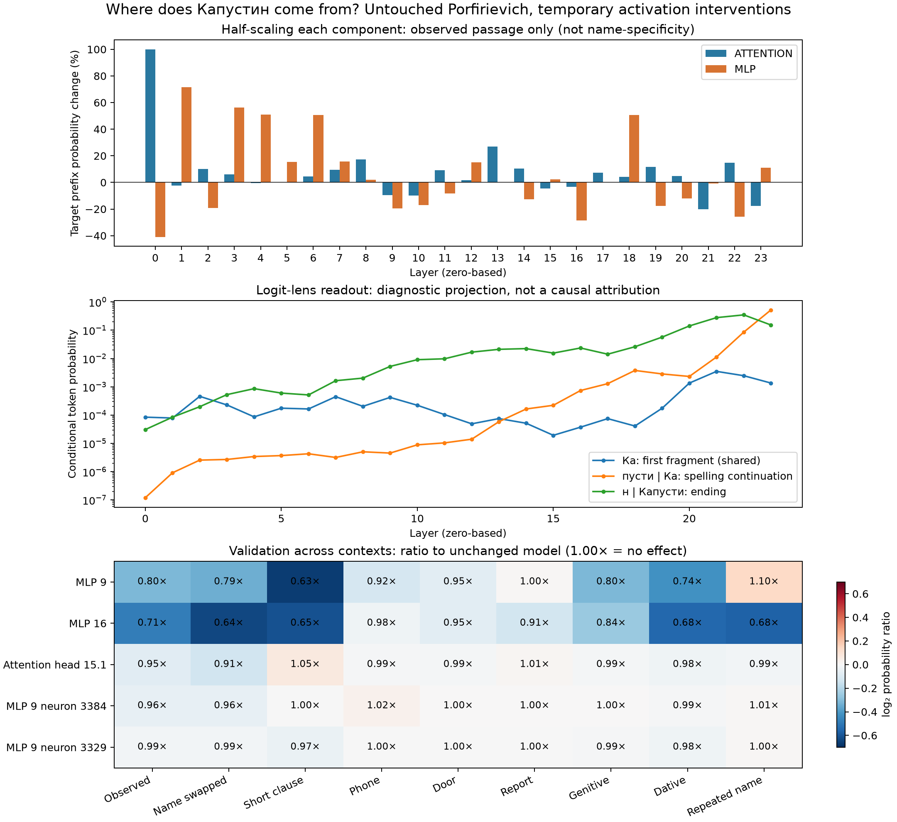

# Where does «Капустин» come from?

## Result

**We located context-dependent contributors to producing the name, not a
unique “Капустин neuron” or a single storage address.** All results use the
untouched recovered checkpoint, float32, without any style patch. Checkpoint
bytes and every loaded parameter tensor have identical hashes before and after.

The best relative-suppression candidates in the observed passage were the MLPs
in layers **16 and 9** (zero-based). Halving their output reduced the token-prefix
probability of «Капустин» by **28.5% and 19.6%**, respectively. The effects were
weaker or different in other contexts and for other grammatical endings.
Attention-head and individual-neuron effects were smaller and less consistent.
This narrow experiment did not establish a component specific to the identity
“Капустин” across contexts, nor rule out more localized features elsewhere.



## What was measured

The natural discovery context is the exact saved, unedited baseline generation
up to, but not including, «Капустин». It ends:

> …Он говорил по-французски — кажется, это и был Гаспаров. Это был худощавый полный мужчина с густой черной шевелюрой. Еще он сказал, что от него хочет сказать

The tokenizer represents the name as **442 / 1057 / 9**, decoded individually
as **Ка / пусти / н**. Its inflections share the first two tokens:
«Капустина» ends in token 208; «Капустину» in 232. These fragments also occur in
other strings; suppressing a fragment is not the same as erasing an entity.

In this context the untouched model assigns:

| Prediction | Raw conditional probability |
| --- | ---: |
| `Ка` given the context | 0.136% |
| `пусти` given the context and `Ка` | 52.0% |
| `н` given the context and `Капусти` | 15.3% |
| The entire three-token prefix | 0.0108% |

The product measures a **token-prefix likelihood**. It includes the possibility
of longer strings starting with those tokens, and is not a calibrated entity
probability, complete-word probability, or observed generation frequency.
There is no temperature, top-p truncation, sampling, or generation seed in this
analysis. Later token scores use teacher forcing; those mainly investigate
completion of an already-started spelling.

## Interventions and controls

- 48 coarse interventions: independently multiply each of 24 attention outputs
  and 24 MLP outputs by 0.5, at all positions. All other activations are computed
  normally. Hooks are removed after every intervention.
- Rank candidates on the discovery passage by
  `ΔlogP(Капустин) - mean ΔlogP(control names)`; smaller is relatively more
  suppressive. Control names are Гаспаров, Сидоров, Петров, Иванов, and Сара.
- Select two attention layers and two MLP layers from this ranking. Test all
  16 heads in each selected attention layer and all 64 contiguous groups of
  64 intermediate neurons in each selected MLP: 32 heads and 128 groups.
- Select three heads and three MLP groups by the same discovery ranking, then
  validate these and the four coarse components on nine contexts and eleven
  target strings. Other probes include Капитан, капуста, человек, and two
  inflections of Капустин.
- As a follow-up, select the already-shortlisted group with the largest absolute
  target suppression, then scan its 64 neurons individually. Validate its two
  strongest suppressors on the same nine contexts. This is exploratory
  follow-up, not independent confirmation.

The additional contexts include a shorter clause, phone/door/report scenarios,
genitive/dative frames, replacing Гаспаров with Сидоров in the observed passage,
and a repeated-name probe. The latter is labeled `copy_positive_control` in
JSON, but does not actually guarantee high name probability. Name replacement
also changes token count, so it is not a position-matched activation-patching
control. All contexts, tokenizations, and runtime versions are in `design.json`.

This is **activation attenuation**, not ROME's corruption-and-restoration
protocol. It probes causal sensitivity of this computation; it does not prove
where a semantic concept is stored. Half-scaling whole components can disturb
general language processing. Comparisons against other names help diagnose
that, but do not completely isolate semantics or control for token-length
sensitivity. Selecting by a relative score can also select components that
raise competitors rather than strongly suppress the target.

## Findings

All indices are zero-based. Probability ratios below refer to the full
three-token Капустин prefix; 1.00 means no effect.

| Half-scaled component | Observed passage | Phone context | Door context | Repeated-name probe |
| --- | ---: | ---: | ---: | ---: |
| MLP layer 16 | 0.715× | 0.980× | 0.951× | 0.675× |
| MLP layer 9 | 0.804× | 0.921× | 0.949× | 1.100× |
| Attention head 15.1 | 0.948× | 0.994× | 0.990× | 0.988× |
| MLP 9, neuron 3384 | 0.961× | 1.020× | 1.002× | 1.006× |
| MLP 9, neuron 3329 | 0.986× | 0.998× | 0.999× | 1.004× |

Layer 0's MLP produced a larger absolute decrease (41%) in the discovery passage,
but was not the strongest name-relative candidate. Layer 16's relative score
was -0.513 nats and layer 9's was -0.392 nats. These are not probabilities or
statistical significance estimates. Attention head 15.1's small absolute
reduction illustrates why relative ranking alone can be misleading.

### Much of the effect is in completing the name

In the discovery context, half-scaling MLP 9 changes the three conditional
probabilities by factors **1.037 / 0.989 / 0.785**. It slightly raises the first
fragment, barely changes the middle, and mainly suppresses the final `н`.
It also suppresses the final `на` and `ну` in the other inflections.

Half-scaling MLP 16 changes them by **0.899 / 0.920 / 0.865**. However, in
«Капустину» its final `ну` probability increases **1.746×**; the complete
Капустину prefix rises **1.444×**. This is not clean, identity-wide removal.
These measurements are in `token-stages.json`.

### A neuron address, but not a character's home

Among the 64 neurons in MLP 9 group 52 (indices 3328–3391), neuron **3384** was
the strongest individual suppressor. Halving it lowers the target by only
**3.9%** in the observed passage. It has almost no effect in several other
contexts and raises the target about 2% in the phone context.

Its concrete parameter locations in this GPT-2 implementation are:

- `transformer.h.9.mlp.c_fc.weight[:, 3384]`
- `transformer.h.9.mlp.c_fc.bias[3384]`
- `transformer.h.9.mlp.c_proj.weight[3384, :]`

The intervention scaled its post-activation value before `c_proj`; none of
those weights was changed. The attention-head candidate 15.1 corresponds to
channels 64–127 entering `transformer.h.15.attn.c_proj`, with the corresponding
Q/K/V channel slices in `c_attn`. These are addresses of measured contributors,
not a demonstrated semantic representation of the character.

### Diagnostic layer readout

`logit-lens.json` projects each intermediate residual state through final layer
normalization and the existing vocabulary head. The spelling fragments become
more readable in later layers. This is an untuned diagnostic projection:
intermediate probabilities are not calibrated, and readout emergence does not
establish the layer where knowledge is stored. The actual causal results are
in the attenuation scans and cross-context validations.

## Integrity and reproducibility

The original checkpoint SHA-256 before and after is:

```
c508fdf6db765a4b1cf11380038233d7bd969ce17a8055368a9095c6dc10089d
```

`integrity.json` and `refinement-integrity.json` also record matching hashes of
all loaded parameter tensors, and exact recovery of baseline scores after
removing hooks. No style patch, weight editor, optimizer, or gradient is used.
The existing user-modified style candidate is not read by this experiment.

From the repository root:

```bash
.venv/bin/python porfirevich-original/experiments/kapustin-trace/trace.py --device mps
.venv/bin/python porfirevich-original/experiments/kapustin-trace/refine.py
# Only needed for figures:
.venv/bin/python -m pip install matplotlib
.venv/bin/python porfirevich-original/experiments/kapustin-trace/render.py
```

The trace script overwrites its experiment JSON reports, never the model files.
Use `--device cpu` for CPU reproduction; refinement follows the recorded device.
The renderer only reads reports. PNG and SVG figures are included. The scripts
use the repository's original runner dependencies, with Matplotlib optional
for rendering.

This pilot checks nine contexts, not a representative corpus. It searches
individual neurons in only one group, not all neurons. It does not identify the
training passage from which the name was learned, establish character knowledge,
or test whether a permanent weight edit would safely suppress the name. A useful
next study would collect many naturally occurring name contexts and perform
position-specific activation replacement with matched controls before attempting
any weight change.

Background: [Causal tracing / ROME](https://rome.baulab.info/) motivated the
localization question; the intervention protocol here is deliberately simpler.
